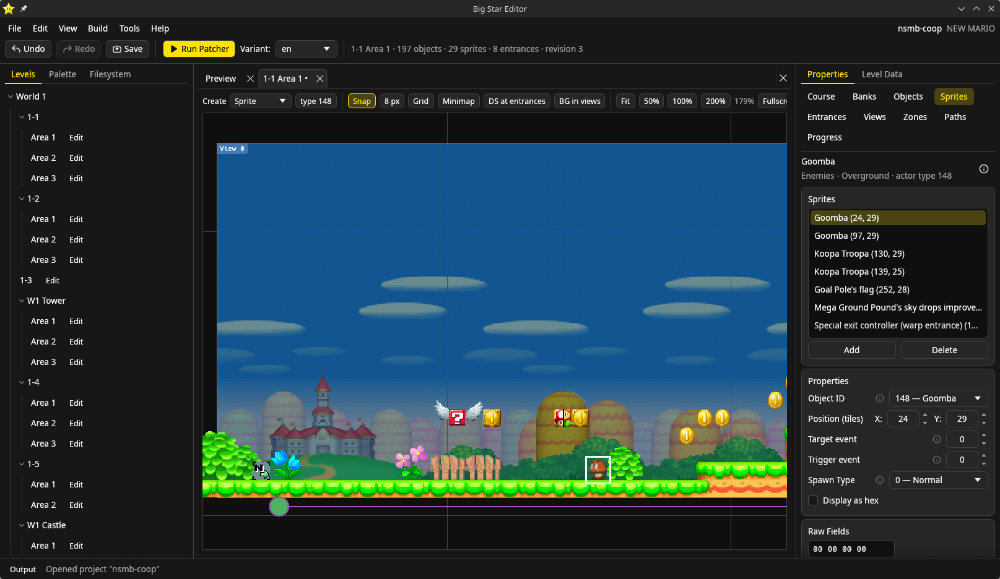

  

<h1 align="center">Big Star Editor</h1>

  A level editor, graphics editor and text editor for <b>New Super Mario Bros.</b> on the Nintendo DS.

  
  
  
  

Big Star Editor lets you build and change New Super Mario Bros. levels the way the game draws them: with its real
tilesets, backgrounds and enemy graphics on screen while you work. Open a ROM and start editing, or set up a project
and let the editor build the game for you.

It does **not** include ROM data, Nintendo SDK files or game assets. You bring your own copy of the game.

## What you can do

### Edit levels

- Place and move **objects, sprites, entrances, zones, views and paths** directly on the level, with snapping, a grid,
  a minimap, zoom, box selection, resizing and Ctrl-drag cloning.
- See what you are building: blocks show the item they hold, sprites are drawn with their real graphics, and a sprite
  the level can't load yet is tinted red, with one button to load what it needs.
- Pick things from a palette or a searchable list of every actor, and fill in their properties in a side panel with
  proper names instead of raw numbers.
- Undo and redo with a named history, copy and paste between levels (and from the older Qt editor), and keep several
  levels open at once in tabs or windows. The editor remembers your workspace for each project.

### Edit the rest of the game

- **Graphics**: palettes, tiles, screens, cells and animations, with PNG import and export. Paint with the palette
  docked beside the canvas, as in NSMB Editor: the left button paints one colour and the right another, with brush,
  fill, line, rectangle, eyedropper and selection tools, zoom, and undo. Bitmaps and palettes are listed side by side,
  as in NSMB Editor's image manager, with its PNG buttons: export a bitmap, import one with the existing palette or
  recreating it, and export or import every bitmap with every palette at once. Any palette goes with any graphics:
  drag one from the Filesystem dock onto an open editor, or open it and choose which editor to attach it to.
- **Tilesets and backgrounds**: paint Map16 blocks and background layers from a tile picker beside them, build objects
  by clicking blocks, set behaviours on many blocks at once, and share tilesets as files.
- **Text**: edit the game's messages, with their special codes, and export or import them as text.
- **Menus and the ROM banner**: the layout pages of the menu screens, the ROM's icon and title, and its user metadata.
- **Anything else** in a hex editor that works like HxD.
- **The file system**: browse the ROM as a folder tree, open archives like folders, and add, replace, extract or remove
  files. Each file opens in the editor that understands it.

### Make it your own

- **Actors, backgrounds and special tiles are Lua scripts.** Add a new enemy or a moving background by writing one
  file that says what it is and how to draw it. See [Lua actors](docs/lua-actors.md),
  [Lua backgrounds](docs/lua-backgrounds.md) and [Lua tiles](docs/lua-tiles.md).
- **Build the game from the editor.** Projects are plain [NCPatcher](docs/ncpatcher-integration.md) folders, so code
  mods build with one click, with progress and errors shown in the Output panel. Pick a *variant* (say, a language)
  and run the patcher. Code modules can also be inspected in a viewer that shows their patches and assembly.
- **Open a ROM directly**, with no project, just like NSMB Editor. Saving writes the changes straight into the file.

### And more

- Works as a **desktop app** (Windows, macOS and Linux) or **in your browser**, from a computer that hosts your projects.
- Automatic **recovery** of unsaved levels, and **backups** of anything a save overwrites.
- Available in **English, Dutch, Portuguese, Spanish and French**.

## Getting started

1. Download the latest installer, disk image or AppImage from the [releases page](https://github.com/Ndymario/Big-Star-Editor/releases).
2. Start the editor and choose **Open ROM…** to edit a `.nds` file, or open a workspace folder holding your
   NCPatcher projects (each has an `ncpatcher.yaml`).
3. Open a level from the **Levels** tab and start editing.

To build a project you also need [NCPatcher](docs/ncpatcher-integration.md) on your `PATH` (or set in Preferences).

## For developers

Building from source, serving the editor to a browser, the command line, and how the code is organised are in
[Building and running from source](docs/building.md) and [Architecture](docs/architecture.md). Project layout is in
[Projects](docs/project-format.md).

## License

Big Star Editor is released under the [GPL-3.0](LICENSE). Third-party licenses are listed in
[docs/licenses.md](docs/licenses.md).
